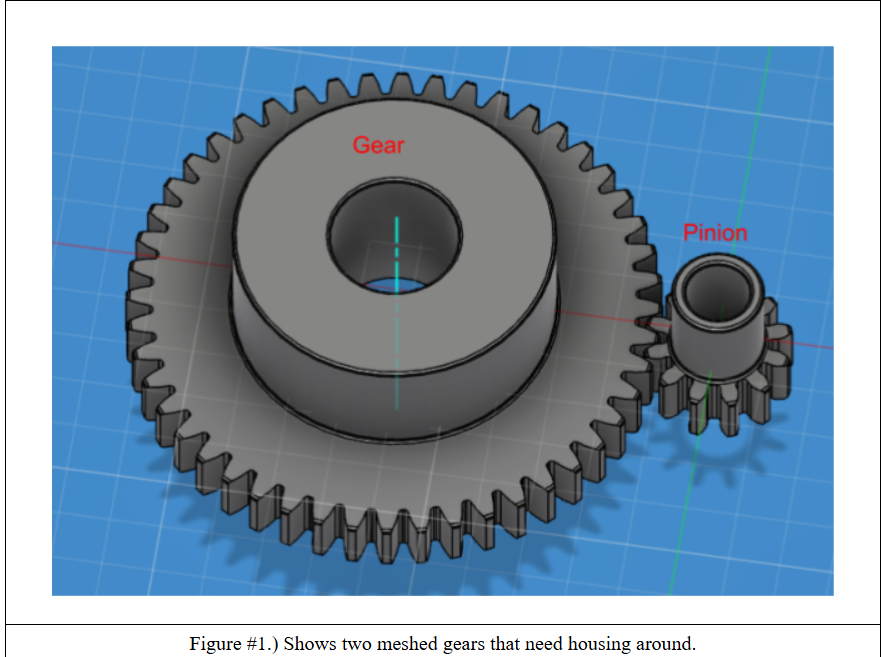
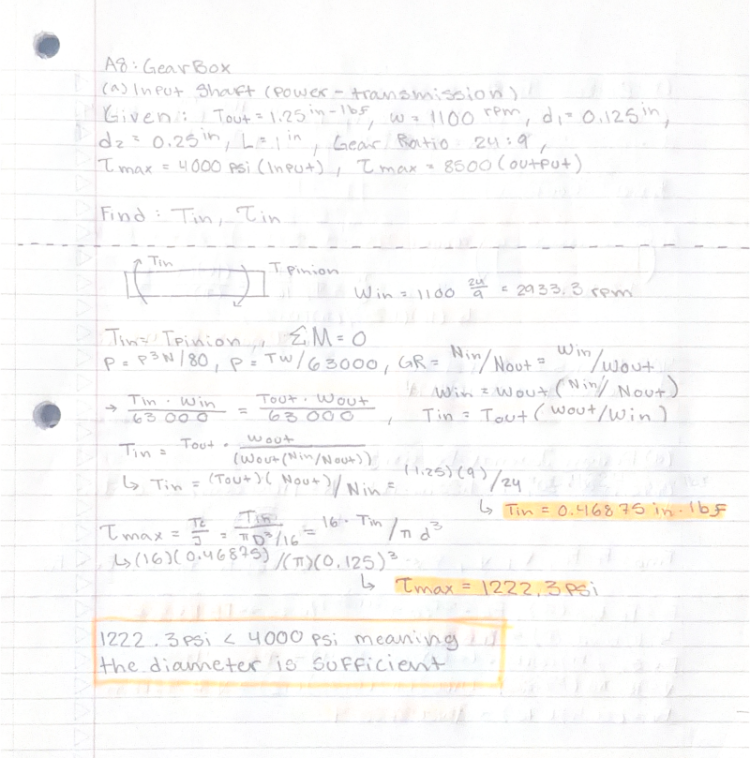
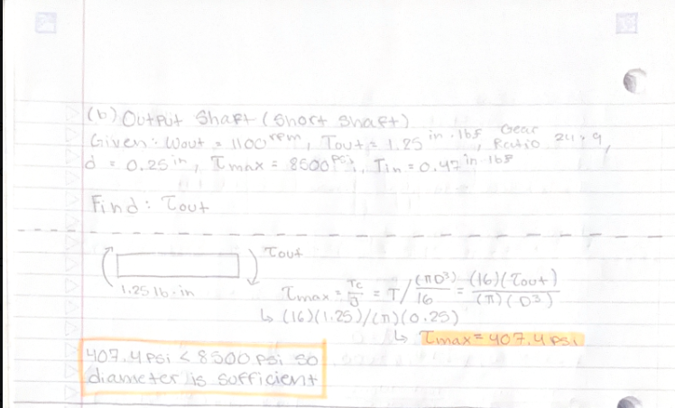
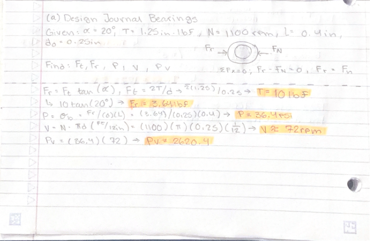
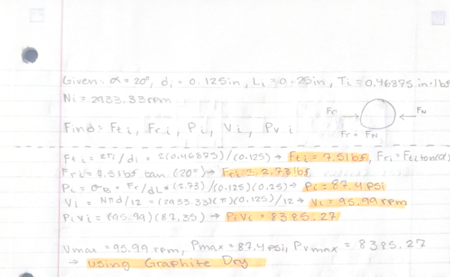
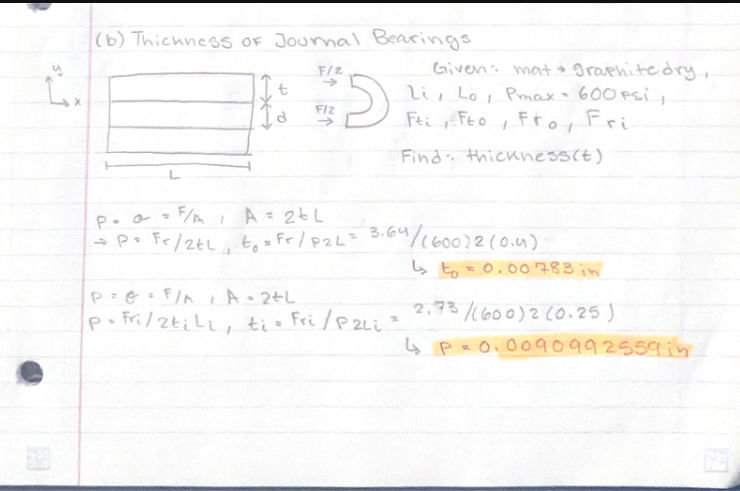
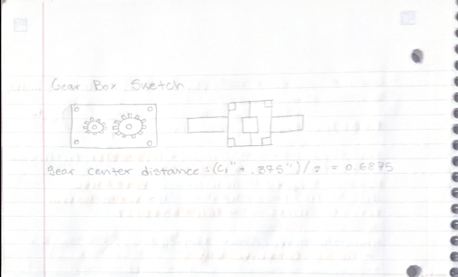

# A8 – Gears

## Objective

For this assignment, I was tasked with designing a gearbox that could be assembled and disassembled. I was given the gear ratio, output torque and speed, and the diameters and lengths of the input and output shafts. I first had to check if the shafts were strong enough and design journal bearings to support them. After completing the calculations, I moved onto SolidWorks to create the gearbox housing and assemble all the components.

<!-- Image 1: Overview of the gearbox design and assignment -->

## Analyze

### Design of the Shafts

The first thing I did was determine if the input and output shaft diameters were sufficient. I listed my knowns and unknowns, drew my free-body diagrams, and used the equations from Machinery's Handbook to calculate the maximum shear stress for each shaft. Due to issues with getting a physical copy I had to ask for equations via a classmate.

#### Input Shaft (Power-Transmission)

The calculated maximum shear stress was approximately 1222.3 psi. This was below the allowable stress of 4000 psi, so the input shaft diameter of 0.125 inches was sufficient.

#### Output Shaft (Short Shaft)

The calculated maximum shear stress was approximately 407.1 psi. This was below the allowable stress of 8500 psi, so the output shaft diameter of 0.25 inches was sufficient.

### Design of the Journal Bearings

After checking the shafts, I moved onto designing the journal bearings. I needed to determine the pressure, surface velocity, and PV rating for each bearing. These calculations helped me decide what material would work best for the application.

#### Output Shaft Bearing

The calculated pressure was approximately 36.4 psi, the surface velocity was approximately 72 ft/min, and the PV value was approximately 2620.4 psi·ft/min.

#### Input Shaft Bearing

The calculated pressure was approximately 87.35 psi, the surface velocity was approximately 95.99 ft/min, and the PV value was approximately 8385.3 psi·ft/min. This was the maximum PV value used when selecting the bearing material.

### Journal Bearing Thickness

After calculating the PV values, I used the material loading capacity to determine the required thickness of each journal bearing.

### Gearbox Housing Sketch

Before creating the CAD model, I made a sketch of the gearbox housing and decided to use nuts and bolts to connect the two halves together. This would allow the gearbox to be assembled and disassembled.

<!-- Image 15: Hand-drawn gearbox housing sketch -->

## Decide

For the shafts, I kept the original diameters of 0.125 inches for the input shaft and 0.25 inches for the output shaft because the calculated stresses were below the allowable values I used.

For the journal bearings, I selected graphite dry based on its PV rating and loading capacity from the material table. I then used the calculated dimensions to model the bearings. The exact McMaster-Carr bearing component should match the selected material, shaft diameter, bearing length, and required clearance.

For the housing, I used two separate halves connected with nuts and bolts so the gearbox could be assembled and disassembled. I also needed to make sure there was enough clearance around the gears and bearings.

## Communicate

### Parametric CAD Modeling

I started the SolidWorks modeling process by entering the known parameters and equations into the equation editor. I created the shafts and journal bearings first, downloaded the gears from McMaster-Carr, and then modeled the gearbox housing.

<!-- Image 16: SolidWorks equation editor and parameters -->

<!-- Image 17: Input shaft CAD model -->

<!-- Image 18: Output shaft CAD model -->

<!-- Image 19: Journal bearing CAD models -->

<!-- Image 20: Gearbox housing first half -->

<!-- Image 21: Gearbox housing second half -->

<!-- Image 22: Gearbox housing assembled -->

### Final Assembly

After creating the individual parts, I brought everything into a SolidWorks assembly. One issue I had was getting the gears to mesh correctly, so I needed to improve the gear positioning and assembly constraints to make sure the gears worked together properly.

<!-- Image 23: Final gearbox assembly isometric view -->

<!-- Image 24: Exploded view of the gearbox -->

### Engineering Drawings – MEGR 2157

The drawing portion of this assignment requires six individual multiview drawings and one complete assembly drawing. The drawings should use third-angle projection, the required tolerance block, and appropriate tolerancing for critical features.

#### Input Shaft Drawing

<!-- Image 25: Fully dimensioned input shaft drawing -->

#### Output Shaft Drawing

<!-- Image 26: Fully dimensioned output shaft drawing -->

#### Housing Half 1 Drawing

<!-- Image 27: Fully dimensioned housing half 1 drawing -->

#### Housing Half 2 Drawing

<!-- Image 28: Fully dimensioned housing half 2 drawing -->

#### Input Shaft Bearing Drawing

<!-- Image 29: Fully dimensioned input bearing drawing -->

#### Output Shaft Bearing Drawing

<!-- Image 30: Fully dimensioned output bearing drawing -->

#### Complete Assembly Drawing

<!-- Image 31: Dimensioned gearbox assembly drawing -->

### CAD Files

The SolidWorks part files, assembly, and other necessary CAD files are available below.

### Lessons Learned

This assignment helped me understand how to check shaft strength, calculate journal bearing pressure and velocity, and use PV ratings to select a bearing material. I also learned more about using parameters in SolidWorks and how important it is to check that all the components fit together correctly.

One issue I ran into was getting the gears to mesh correctly in the assembly. This showed me that making the individual parts is only one part of the process, since the components also need to fit and work together properly. Another thing I learned was that starting earlier would have made the modeling process less stressful, especially because some of the SolidWorks assembly steps were new to me.

This assignment took me about 9–10 hours to complete.
