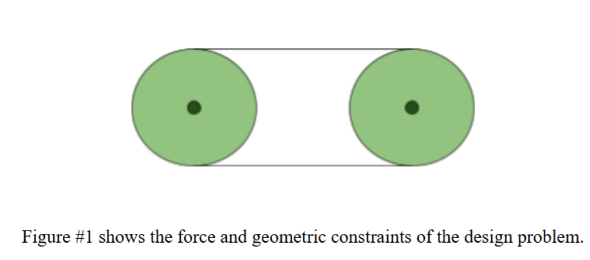
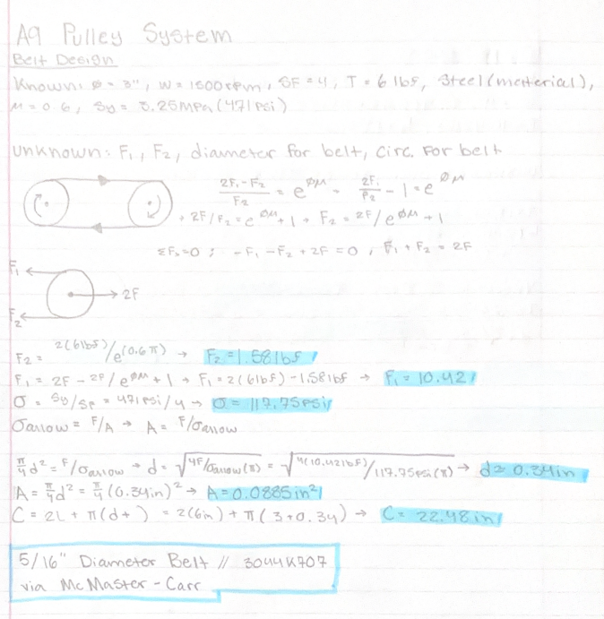
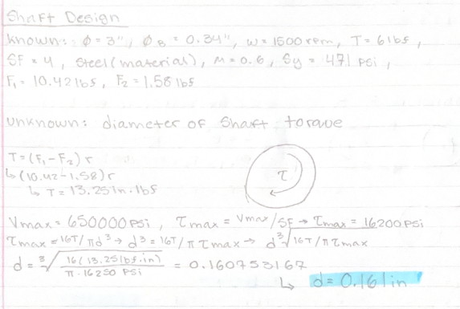
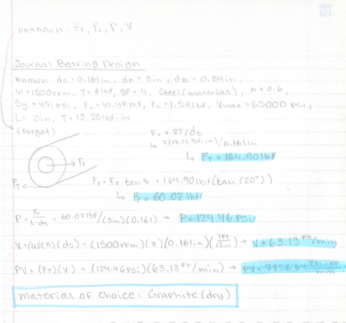
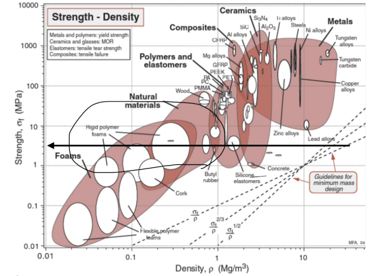
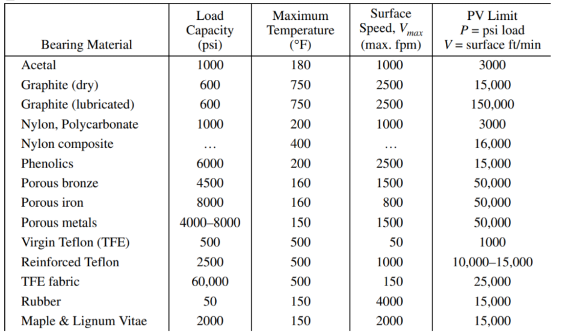
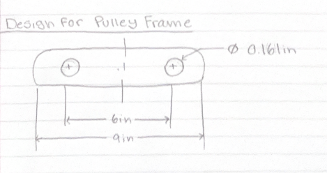

# A9 – Pulleys

## Objective

The goal of this assignment was to design a pulley system that transfers power between two parallel shafts. The system needed to use two 3-inch diameter pulleys with a center distance between 4 and 6 inches. I also had to select an operating speed between 1000 and 2000 rpm while maintaining a belt tension between 4 and 6 lbf. Additionally, the design needed to meet a minimum safety factor of 3.

The assignment involved selecting a suitable belt, calculating the minimum shaft diameter, choosing journal bearing materials, and designing a frame to support the pulley system.

## Analyze

### Belt Design

The first step was selecting a suitable belt for the pulley system. To do this, I needed to calculate the forces acting on both the tight and loose sides of the belt while preventing slippage. I also used the normal stress equation and the belt's yield strength to determine the required belt diameter. After calculating the outside circumference, I could compare my results with available belts.

I started by listing my knowns and unknowns and drawing an FBD of the pulley system. From there, I used the friction and stress equations to solve for the remaining values.

### Shaft Design

After selecting the belt, I moved on to calculating the minimum diameter needed for the shafts. Since the shafts would be transmitting torque from the pulleys, I needed to make sure they could withstand the applied shear stress.

I selected 1060 hardened steel for the shafts and used its maximum shear strength of approximately 65,000 psi. Using the belt forces, I calculated the torque acting on the shafts and then used the torsion equation to determine the minimum required diameter.

### Journal Bearing Design

The next step was selecting a suitable material for the journal bearings. These bearings needed to be made from either sintered metal or a non-metallic material.

Before selecting a material, I calculated the bearing pressure, linear velocity, and PV rating. I then compared these values with Table 4 in the Machinery's Handbook to determine which material would be able to handle the operating conditions.

### Frame Design

The final part of the analysis was determining what material would work best for the frame supporting the pulley system. I initially wasn't sure how to approach this section, but after reviewing previous examples, I found that Ashby plots could be used to compare materials based on their mechanical properties.

I used the calculated journal bearing pressure and multiplied it by my selected safety factor of 4 to determine the required material strength. After reviewing the Ashby plot, I identified rigid polymer foam, cork, and butyl rubber as possible materials for the frame.

I also created a basic sketch showing how the frame could support both shafts while maintaining the required center distance.

## Decide

For the belt, I selected a 5/16-inch diameter polyurethane round belt from McMaster-Carr. The reference design used part number 3044K707 because its dimensions were close to the calculated belt requirements.

For the shafts, I selected 1060 hardened steel because of its shear strength. My calculations determined the minimum shaft diameter needed to withstand the applied torque while maintaining the selected safety factor.

For the journal bearings, I selected dry graphite. Based on the reference design's calculations and the limits listed in Table 4, the material was able to handle the calculated pressure, surface velocity, and PV rating.

For the frame, I identified rigid polymer foam, cork, and butyl rubber as possible materials using the Ashby plot. These materials were selected because their strength ranges were close to the calculated requirements while also keeping the overall design relatively lightweight.

## Communicate

This assignment helped me understand how different engineering concepts work together when designing a mechanical system. I had to use friction, torque, shear stress, bearing pressure, and material properties to make decisions about each component.

One thing I learned was how important material selection is because each component has different requirements depending on what it needs to withstand. The shafts needed to handle torsional loading, while the journal bearings needed to handle pressure and surface velocity. I also learned how Ashby plots can make the material selection process easier by allowing different materials to be compared based on their properties.

Another part of the assignment that helped me was working with belt friction. I have a better understanding of how friction affects the forces on the tight and loose sides of a belt and how these forces relate to torque being transferred through a pulley system.

**Time to complete:** 4-5 hours
